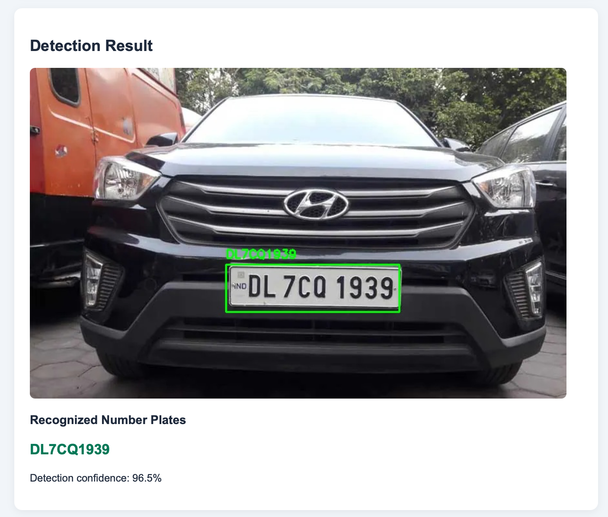
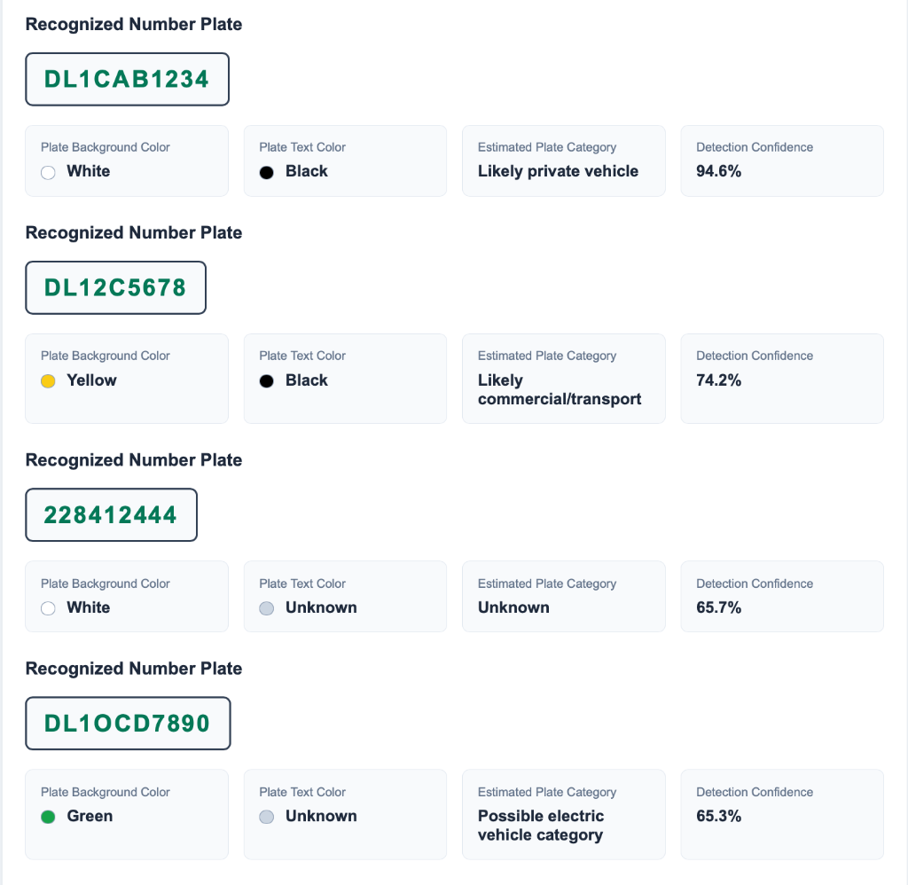
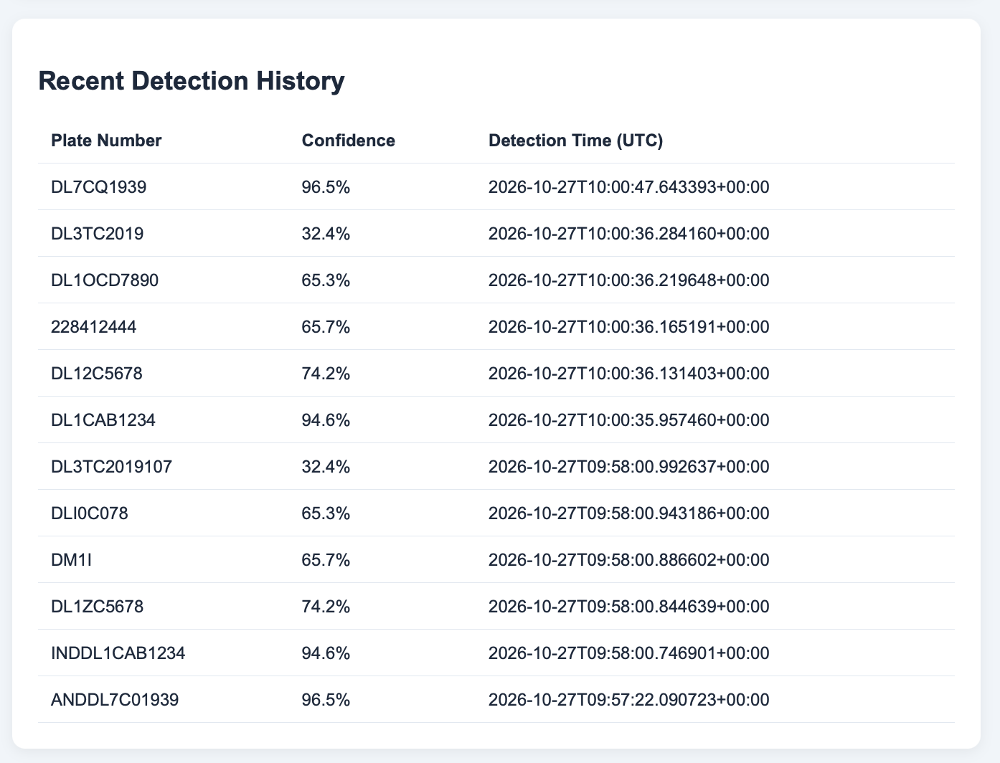
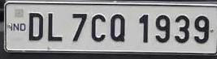
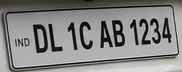
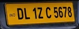
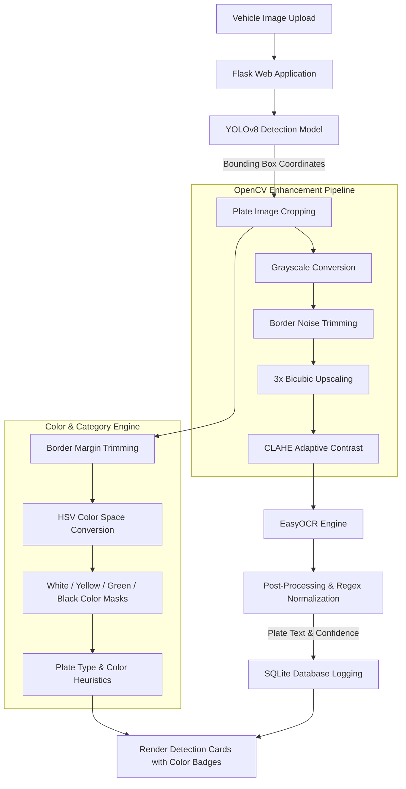

# 🚗 AI License & Number Plate Detection System (ANPR)

[](https://www.python.org/)
[](https://flask.palletsprojects.com/)
[](https://github.com/ultralytics/ultralytics)
[](https://opencv.org/)
[](https://github.com/JaidedAI/EasyOCR)
[](https://www.sqlite.org/)

An end-to-end, deep learning-powered **Automated Number Plate Recognition (ANPR)** web application. This system integrates a fine-tuned **YOLOv8** model for high-precision license plate localization, an advanced **OpenCV computer vision preprocessing pipeline** (CLAHE adaptive contrast enhancement, bicubic upscaling, edge noise cropping), **EasyOCR** with regex-based Indian vehicle registration normalization, and an **HSV color segmentation engine** to classify plate background, text color, and heuristic vehicle registration categories.

---

## 📸 Visual Showcase

### 1. Real-Time Detection & Recognition
Accurate plate boundary localization with confidence score and extracted alphanumeric decoding.

<p align="center">
  
</p>

---

### 2. Plate Color & Category Analysis
Each detected plate undergoes multi-channel HSV segmentation to determine plate background and character text colors, mapping them to standard vehicle registration categories (e.g., Private, Commercial, EV).

<p align="center">
  
</p>

| Number Plate | Plate Background | Plate Text Color | Estimated Plate Category | Confidence |
| :--- | :---: | :---: | :--- | :---: |
| `DL1CAB1234` | ⚪ White | ⚫ Black | **Likely private vehicle** | **94.6%** |
| `DL12C5678` | 🟡 Yellow | ⚫ Black | **Likely commercial/transport** | **74.2%** |
| `228412444` | ⚪ White | 🔘 Unknown | **Unknown** | **65.7%** |
| `DL1OCD7890` | 🟢 Green | 🔘 Unknown | **Possible electric vehicle category** | **65.3%** |

---

### 3. Detection History & Audit Logging
Every processed plate is saved with its cropped image reference, detection confidence, and UTC timestamp into an SQLite datastore.

<p align="center">
  
</p>

---

### 4. Cropped License Plate Samples (`detected_plates/`)
The system extracts individual plate bounding boxes and applies custom OCR filtering to extract crisp, readable text even from varied lighting and angles.

| Sample Plate Crop | Detected Text | Detection Confidence | Plate Type |
| :---: | :---: | :---: | :---: |
|  | `DL7CQ1939` | **96.5%** | Private Vehicle (White Plate) |
|  | `DL1CAB1234` | **94.6%** | Private Vehicle (White Plate) |
|  | `DL1ZC5678` | **74.2%** | Commercial Vehicle (Yellow Plate) |

---

## ✨ Key Features

- **⚡ Ultralytics YOLOv8 Detection**: Accurately detects number plates across challenging angles, vehicle types (cars, cabs, SUVs), and resolutions.
- **🎨 Color Analysis & Registration Category Heuristics**:
  - **HSV Color Segmentation**: Evaluates Hue, Saturation, and Value masks (White, Yellow, Green, Black) on the plate interior while trimming outer border noise.
  - **Character Stroke Estimation**: Detects text stroke contrast against the primary background color.
  - **Category Classification**:
    - ⚪ White background + ⚫ Black text &rarr; **Likely private vehicle**
    - 🟡 Yellow background + ⚫ Black text &rarr; **Likely commercial/transport**
    - 🟢 Green background &rarr; **Possible electric vehicle category**
    - ⚫ Black background + 🟡 Yellow text &rarr; **Possible special-use category**
  - **Dynamic Visual Indicators**: Real-time color dots and classification badges on detection result cards.
- **🔬 Advanced OpenCV Preprocessing**:
  - **Dynamic Margin Trimming**: Crops out plate borders (12% top, 10% bottom, 3% sides) to eliminate frame noise and rivet artifacts.
  - **3× Bicubic Upscaling**: Interpolates small or low-resolution crops to provide legible text strokes.
  - **CLAHE (Contrast Limited Adaptive Histogram Equalization)**: Equalizes localized lighting variations to enhance character contrast.
- **🇮🇳 Smart OCR Cleaning & Indian Plate Normalization**:
  - Whitelist enforcement for uppercase alphanumeric characters `[A-Z0-9]`.
  - Automatic removal of `IND` country identifier prefix artifacts.
  - Regular expression pattern matching (`[A-Z]{2}\d{1,2}[A-Z]{1,3}\d{4}`) to eliminate stray symbols and characters.
- **💾 SQLite Datastore**:
  - Persistent history log with timestamps, confidence scores, original images, and cropped plate assets.
- **🌐 Clean & Lightweight Web UI**:
  - Built with Flask and Vanilla HTML/CSS with instant feedback, file validation, and history inspection.
- **🚀 Automated Model Fetching**:
  - Built-in Hugging Face Hub integration that automatically downloads the YOLOv8 weights on first launch.

---

## 🏗️ System Architecture



---

## 📁 Project Structure

```text
number-plate-detection/
├── app.py                      # Core Flask app, OCR inference & color classification
├── download_model.py           # Automated model weight downloader from Hugging Face
├── requirements.txt            # Python package dependencies
├── .env                        # Local environment configuration
├── .gitignore                  # Git ignore rules for environments, cache & DB
├── plates.db                   # SQLite database for storing detection history
│
├── assets/                     # Documentation media & screenshots
│   ├── detection_preview.png   # Full detection view screenshot
│   ├── plate_analysis_preview.png # Color & category detection result cards
│   ├── history_preview.png     # History table screenshot
│   └── plates/                 # Sample cropped plate showcases
│
├── models/
│   └── best.pt                 # YOLOv8 fine-tuned number plate weights (~6.2 MB)
│
├── templates/
│   └── index.html              # Responsive web UI template with dynamic color badges
│
├── uploads/                    # Temporary storage for uploaded vehicle images
└── detected_plates/            # Saved plate crops generated during inference
```

---

## 🚀 Getting Started

### 1. Clone the Repository
```bash
git clone https://github.com/mohdajnas/AI-number-plate-detection.git
cd AI-number-plate-detection
```

### 2. Create and Activate Virtual Environment
```bash
# macOS / Linux
python3 -m venv venv
source venv/bin/activate

# Windows
python -m venv venv
venv\Scripts\activate
```

### 3. Install Dependencies
```bash
pip install -r requirements.txt
```

### 4. Download Model Weights
You can either run the download script manually or let `app.py` fetch it automatically on initial startup:
```bash
python download_model.py
```

### 5. Launch the Application
```bash
python app.py
```
Open your browser and navigate to:
```text
http://127.0.0.1:5000
```

---

## ⚙️ How the OCR Enhancement Works

In `app.py`, raw crops often have low resolution, poor lighting, or border artifacts that confuse standard OCR models. The custom `read_plate()` pipeline addresses this in four distinct steps:

```python
# 1. Grayscale Conversion
gray = cv2.cvtColor(crop, cv2.COLOR_BGR2GRAY)

# 2. Border Noise Removal (eliminates plate borders & screws)
h, w = gray.shape
gray = gray[int(h * 0.12):int(h * 0.90), int(w * 0.03):int(w * 0.97)]

# 3. 3x Bicubic Upscaling
gray = cv2.resize(gray, None, fx=3, fy=3, interpolation=cv2.INTER_CUBIC)

# 4. Contrast Limited Adaptive Histogram Equalization (CLAHE)
gray = cv2.createCLAHE(clipLimit=2.0, tileGridSize=(8, 8)).apply(gray)

# 5. EasyOCR with Alphanumeric Allowlist
results = reader.readtext(gray, detail=0, allowlist="ABCDEFGHIJKLMNOPQRSTUVWXYZ0123456789")

# 6. Format Normalization (strips 'IND' and extracts standard pattern)
match = re.search(r"([A-Z]{2}\d{1,2}[A-Z]{1,3}\d{4})", text)
```

---

## 🎨 How the Plate Color & Category Analysis Works

In `analyze_plate_color(crop)` in `app.py`, the system isolates the interior plate region and computes pixel coverage across HSV color thresholds:

```python
# 1. Focus on inner plate region (excluding outer mounting border)
inner = crop[int(h * 0.15):int(h * 0.85), int(w * 0.08):int(w * 0.92)]
hsv = cv2.cvtColor(inner, cv2.COLOR_BGR2HSV)

# 2. HSV color masking for dominant background colors
white_mask  = (saturation < 65) & (value > 145)
yellow_mask = (hue >= 15) & (hue <= 40) & (saturation > 70) & (value > 90)
green_mask  = (hue >= 35) & (hue <= 90) & (saturation > 55) & (value > 50)
black_mask  = value < 75

# 3. Determine dominant background and contrasting text color
background = max(scores, key=scores.get)

# 4. Heuristic vehicle registration classification
if background == "White" and text_color == "Black":
    plate_type = "Likely private vehicle"
elif background == "Yellow" and text_color == "Black":
    plate_type = "Likely commercial/transport"
elif background == "Green":
    plate_type = "Possible electric vehicle category"
elif background == "Black" and text_color == "Yellow":
    plate_type = "Possible special-use category"
```

---

## 🗄️ Database Schema

The SQLite database (`plates.db`) manages detections using the following schema:

```sql
CREATE TABLE detections (
    id INTEGER PRIMARY KEY AUTOINCREMENT,
    plate_number TEXT NOT NULL,
    image_path TEXT NOT NULL,
    plate_image_path TEXT NOT NULL,
    confidence REAL NOT NULL,
    detected_at TEXT NOT NULL
);
```

---

## 🛠️ Tech Stack & Libraries

- **Framework**: [Flask](https://flask.palletsprojects.com/)
- **Object Detection**: [Ultralytics YOLOv8](https://github.com/ultralytics/ultralytics) (pretrained checkpoint: `Koushim/yolov8-license-plate-detection`)
- **Computer Vision**: [OpenCV (`opencv-python`)](https://opencv.org/)
- **Optical Character Recognition**: [EasyOCR](https://github.com/JaidedAI/EasyOCR)
- **Model Hub**: [Hugging Face Hub](https://huggingface.co/)
- **Database**: [SQLite3](https://sqlite.org/)

---

## 📄 License
This project is open-source and available under the [MIT License](LICENSE).
